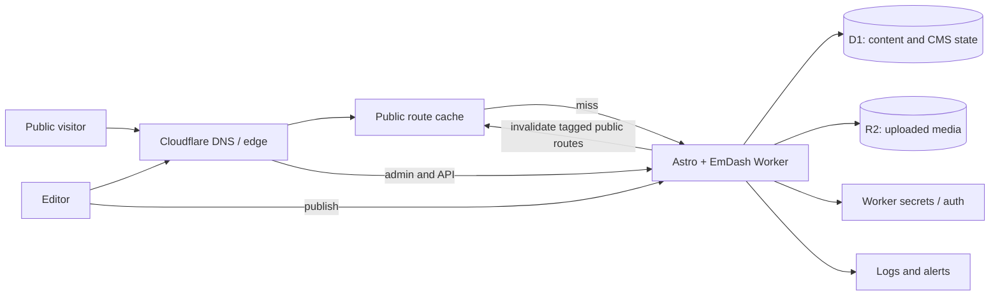

# MORazon website: architecture assessment and client discovery

Assessment date: 4 November 2026. Scope: analysis only; no application or infrastructure has been created.

**Evidence labels.** **Verified** means observed in `.prototype/` or in the linked official documentation. **Recommendation** is a proposed decision for the new site. **Assumption** is a planning placeholder. **Client decision** marks a requirement that cannot be established from the prototype. The HTML is a visual and interaction reference, while `.prototype/MORazon-Website-Implementation-Spec.md` adds explicit brand and content instructions. They conflict on several points; neither is evidence that the client approved a final production design.

## 1. Executive summary

- **Verified:** The delivered site prototype is one HTML document, not a set of implemented product or company pages. Its five desktop menus and four product-family cards predominantly link to the old `MORazon.com` site. Search is visual only; contact is an external link; there is no form. The page contains many reusable sections and enough navigation to suggest a larger information architecture, but that architecture has not been delivered. Evidence: [HTML navigation](.prototype/MORazon-prototype.html), lines 754-872; [product cards](.prototype/MORazon-prototype.html), lines 985-1043; [footer](.prototype/MORazon-prototype.html), lines 1453-1500.
- **Verified:** The prototype uses inline CSS, native JavaScript, 42 inline SVG symbols, three repeated base64 logo images, and Google-hosted Geist fonts. There is no public React UI or third-party JavaScript library. The adjacent implementation spec says the HTML's old product copy, model claims, orange accent, base64 logo, and dark theme are **not** approved for production. Evidence: [HTML head/tokens](.prototype/MORazon-prototype.html), lines 1-78; [spec source hierarchy](.prototype/MORazon-Website-Implementation-Spec.md), sections 0 and 14.
- **Recommendation:** Build the public site with Astro components, semantic HTML, a unified vanilla-CSS token system, and small native scripts for the existing controls. EmDash's admin requires the Astro React integration; that does **not** require hydrating the public UI with React. Use EmDash's normal Astro server rendering on Cloudflare Workers, D1 for content, R2 for media, and tagged route caching for published content. [EmDash Cloudflare guide](https://docs.emdashcms.com/deployment/cloudflare/), [content querying](https://docs.emdashcms.com/guides/querying-content/), [route caching](https://docs.emdashcms.com/deployment/route-caching/).
- **Client decisions that gate scope:** approved design and current claims; one-page versus separate routes; whether the four cards are families or editable product records; which corporate content editors control; languages; existing URL preservation; contact/portal behavior; and who owns Cloudflare, DNS, operations, and recovery.

## 2. Prototype inventory and analysis

### Repository and route inventory

**Verified:** The project root currently has an empty `AGENTS.md` and `.prototype/`; no Astro package, source tree, configuration, or Git checkout is present. Within `.prototype/` there is one HTML file, one implementation spec, one palette PNG, `Archive.zip`, six extracted source logo SVGs plus Illustrator/PDF masters, three web-ready logo SVGs, and macOS metadata in `Archive/__MACOSX/`. There are no separate CSS, SCSS, JS, font, product-photo, or product-page files.

| Implemented page/route | Evidence | What it actually contains |
|---|---|---|
| Prototype root document only | `.prototype/MORazon-prototype.html` | One page with internal anchors such as `#products`, `#ams`, `#platform`, `#solutions`, and `#integrations`. It has no Astro or server-side routing. |
| Products, platform, solutions, services, company, portal, contact | Header/footer `href` attributes, lines 754-872 and 1453-1499 | External links to the existing `https://MORazon.com/...` website, **not** pages present in this prototype. Destination health and migration mapping have not been audited. |

### Page and section inventory

The table records the **visual pattern**, not approval of the displayed claims. Text, model codes, diagrams, and URLs may be stale according to the implementation spec (section 14). Every section uses the shared 1200px `.wrap` container unless otherwise noted.

| Order / source | Purpose and layout | Reusable components | Likely content dependency / open issue |
|---|---|---|---|
| Header `#nav`, lines 754-826 | Sticky 68px bar, brand, five dropdowns (Products, Platform, Solutions, Services, Company), search, Portal/Contact actions | Brand, menu button, multi-column dropdown, icon button, CTA | Navigation labels/destinations need approved IA. Search has no results behavior. Portal destination needs confirmation. |
| Mobile `#mnav`, 827-872 | Fixed full-screen menu; native `details` accordions and CTAs | Mobile menu, accordion | Same IA as desktop; focus and keyboard handling need production review. |
| Hero, 875-974 | Centered announcement, H1, lead, two actions, chips; framed animated ecosystem SVG; simplified mobile list | Announcement, buttons, chips, diagram frame | Approved headline, announcement, diagram accuracy, CTA destinations, and imagery. |
| Technology strip, 975-984 | Label and continuously moving horizontal token marquee | Token, marquee | Standards/partner names require factual and legal review. |
| Products `#products`, 985-1043 | Four two-column family cards with CSS-drawn product wells, descriptions, model chips | Product-family card, model chip | Family taxonomy, approved model names, real images, and link behavior. Not yet evidence of individual product pages. |
| AMS `#ams`, 1044-1170 | Tinted band, feature introduction, mock application console with sidebar, tabs, KPIs, chart, calls, logs, PA zones | Feature point, mock console, data tile, tab, table | Demo data is simulated. Confirm whether to replace with approved screenshots or keep a clearly labeled demo. |
| Platform `#platform`, 1171-1185 | Left tab selector with right illustration/copy panel; seven modules generated in JS | Tab selector, feature panel | Module names, claims, illustrations and deep links are placeholders. |
| Landscape `#landscape`, 1186-1212 | Text beside three connected Edge/Fog/Cloud layer cards | Layer card, connector | Validate deployment narrative and diagram claims. |
| Solutions `#solutions`, 1213-1255 | Six illustrated cards in a three-column grid | Solution card, mini scene | Confirm which solution topics deserve detail routes and approved visuals. |
| EN81 feature split, 1256-1319 | Text/features beside an animated lift-shaft SVG | Feature list, technical diagram | Compliance wording and diagrams need technical/legal approval. |
| Hardware `#hardware`, 1320-1346 | CSS-rendered device on left, attributes and lineup links on right | Hardware feature, lineup row | Real product photography, model list, and available product records. |
| Integrations `#integrations`, 1347-1388 | Vendor columns, central hub/wires, protocol chips, featured integration row | Vendor item, protocol chip, feature row | Confirm current integration partners and permissions to display their names/logos. |
| Critical `#critical`, 1389-1416 | Tinted bento grid with a large code/claim box and six smaller capabilities | Bento box, icon+copy feature | Claims and code example require review; layout can be reused. |
| Enterprise `#enterprise`, 1417-1435 | Six capability cells in a divided 3x2 grid | Feature cell | Approved security, reliability, scalability claims. |
| Closing CTA, 1436-1452 | Centered copy and buttons over animated rings | CTA band | Confirm desired conversion path. |
| Footer, 1453-1501 | Brand/social block, five link columns, copyright and theme toggle | Footer group, social icon, theme switch | Footer IA, privacy/legal, social ownership, copyright and dark-theme approval. |

The prototype is **genuinely one implemented page**, but its navigation implies a possible multi-page future. A production sitemap cannot be inferred from the old external destinations alone.

### Interactions and behavior

| Interaction and evidence | Current classification | Architecture implication |
|---|---|---|
| Sticky border on scroll; smooth anchor scrolling; scroll reveal via `IntersectionObserver` (JS lines 1508-1511, 1639-1645) | Native JS/CSS | Small isolated scripts; honor reduced motion. |
| Desktop dropdowns open on click or fine-pointer hover, close on outside click/Escape (1513-1528) | Native JS + CSS | Astro markup and native script suffice. Add robust keyboard semantics and focus behavior. |
| Mobile overlay opens/closes, locks body scroll; `details` submenus (1529-1538) | Native JS + native HTML | No React requirement; manage focus return/trap and hidden-state tab stops. |
| Product/solution card lifts, arrow nudges, hardware tilt, diagram pulses/flows, marquee (CSS lines 95-700) | CSS; marquee duplicated by native JS | Preserve only approved, useful motion and accessible pause/reduced-motion behavior. |
| AMS tab switch, simulated meters, timers, event log (1539-1582) | Native JS demo | These are not live product integrations; do not model them as real data. |
| Platform seven-tab switcher, automatic 6-second advance and dynamic panel markup (1584-1637) | Native JS | Rebuild as server-rendered tab content plus a small controller. React island is optional only if later interactions justify it. |
| Theme toggle persisted to `localStorage` (1648-1658 and body pre-loader line 705) | Native JS | Existing behavior conflicts with spec's light-only direction; require design approval. |
| Search pill and `/` shortcut (header and 1660-1661) | Nonfunctional native JS | Either implement a real search scope/results UI or remove the affordance. |
| Contact / Portal / social links | External integration by navigation | No form, CRM, email, search service, modal, slider, or carousel implementation is present. |

**Accessibility gaps visible in source:** the header lacks a `nav` landmark and skip link; dropdown triggers lack explicit `aria-controls`/menu relationships; tab keyboard arrow behavior is absent; the mobile overlay toggles visibility without focus management. The prototype includes visible focus styles, several ARIA states, and reduced-motion handling (CSS lines 69-85, 698-702). These observations are code-level; no browser or assistive-technology audit was performed.

## 3. Existing design system

### What the HTML renders

**Verified in** [HTML CSS](.prototype/MORazon-prototype.html), lines 7-703: light background `#FFFFFF`, pale surface `#F6F7F9`, dark ink `#0D1C2A`, primary blue `#2350F0`, orange signal `#E0690A`, muted `#5E6978`, hairline borders `#E6E9EE`. A full `:root.dark` token set is included. Fonts are remote Geist 400/500/600/700 and Geist Mono 400/500/600, with system fallbacks. Body is 16px/1.6; section H2 `clamp(2rem,4.2vw,3.35rem)`; hero H1 `clamp(2.55rem,7vw,5.6rem)`, 600 weight. The CSS uses tightly tracked display headings and uppercase mono labels.

**Verified in** [palette PNG](.prototype/colour-roles-palette.png) and [implementation spec](.prototype/MORazon-Website-Implementation-Spec.md), sections 4, 12 and 14: the supplied brand palette says to replace the HTML's orange and off-palette colors, obsolete PNG logo, old copy, and unapproved dark theme. The brand palette is Deep Navy `#041C2B`, Electric Blue `#1F3FE6`, Comm. Cyan `#00A8F4`, Signal Blue `#1476FF`, Slate Navy `#0A3348`, Graphite `#676767`, Silver `#D8D8D8`, Ice Blue `#EAF7FF`, plus white. Cyan and Signal Blue need contrast checks before use as small text. **Client decision:** confirm that this palette/spec supersedes the literal HTML screenshot.

| Token group | Observed rule / proposed reusable token |
|---|---|
| Color | Retain semantic names such as `--bg`, `--surface`, `--ink`, `--muted`, `--primary`, `--border`, `--signal`; map to approved values after sign-off. Separate demo-console status colors from marketing palette. |
| Type | `--f-display` / `--f-body` = Geist; `--f-mono` = Geist Mono; preserve documented type roles and weights. Self-host fonts later if licensing and deliverables are confirmed. |
| Layout | `--wrap:1200px`, `--gutter:clamp(16px,4vw,32px)`, section block padding `clamp(72px,10vw,132px)`, `.sec-head` max 760px. |
| Grid | Products 2 columns; solutions/enterprise 3; bento 6 tracks; platform 320px + fluid; footer 1.4fr + five 1fr. All collapse at documented breakpoints. |
| Shape/elevation | `--r-sm:8px`, `--r:12px`, `--r-lg:18px`, `--r-xl:24px`; two layered shadows `--shadow` and `--shadow-lg`; 1px borders; large rounded demo panels. |
| Controls | Buttons: 44px high (small 36px), primary/ghost/accent variants; 14px arrow links; pill chips; square icon tiles; clear hover/focus treatment. |
| Motion | 0.15-0.25s hover transitions; 0.8s reveal; 48s marquee; demo animation keyframes; `prefers-reduced-motion` disables motion. |

**Recommendation:** extract tokens and base styles from the existing CSS, preserve component geometry, and compare at 1440/1024/768/390px before accepting color remapping. Do not treat the spec's palette mapping as pixel identical to the HTML: Ice Blue surfaces and Silver borders will look materially different from the HTML's gray ones.

### Assets, reuse, and reference health

| Asset | Observation | Production use |
|---|---|---|
| `MORazon-prototype.html` (177,903 bytes) | 3 repeated inline base64 PNG logos; CSS-drawn product devices and UI scenes; no real product photo or local font. | Use as visual/interaction reference, not as a production asset bundle. Replace repeated embedded PNG. |
| Inline icon sprite | 42 `<symbol>` definitions used via `<use>`. | Reuse or split into a controlled sprite if icon rights are approved. |
| `logo-web/` | Navy/white wordmarks and navy symbol are small web SVGs (about 1.5-4.8 KB) derived from the master. They are not referenced by the HTML. | Best current web assets; the spec requests future designer exports. Choose appropriate color variant, no CSS inversion. |
| `Archive/` and `Archive.zip` | Six full-artboard SVG variants; .ai (252 KB), PDF (86 KB); zip duplicates their source contents and includes `__MACOSX` metadata. Some SVGs contain background rectangles and live text. | Source/print assets, not direct header logos. Exclude duplicate archives and metadata from shipped assets. |
| `colour-roles-palette.png` (35,765 bytes) | Brand color reference, not page imagery. | Design reference only. |
| Google Fonts URL | Only remote resource loaded in HTML. | Decide self-hosting/consent policy; retain fallbacks. |

The HTML's literal local fragment links resolve to source IDs; the apparent unresolved icon reference is a JavaScript template evaluated at runtime. External destinations have **not** been verified. The largest practical media gap is missing approved product photography and screenshots, not an oversized existing raster library. Any new CMS images should have dimensions, alt text, responsive derivatives, and a documented source/licence.

### Responsive baseline and gaps

| Width | Observed CSS behavior (lines 622-703) |
|---|---|
| >1180px | Full desktop menus, three-column solutions, two-column products, full console sidebar and ecosystem SVG. |
| <=1180px | Search pill becomes icon-only; wide dropdown narrows. |
| <=1024px | Desktop menus/search/Portal button hide; burger and full-screen mobile menu appear. Two-column feature layouts stack; platform tabs scroll horizontally; solution grid becomes two columns; console sidebar hides. |
| <=768px | Products and enterprise grids become one column; hero SVG changes to mobile text list; bento/feature splits stack; marquee label moves above content. |
| <=640px | Solutions and attributes become one column; CTA buttons stretch; footer becomes two columns; hardware callouts hide. |
| <=480px | PA zones and mobile ecosystem list become one column; compact console metrics. |

**Gap:** no separate approved mobile/tablet comps or browser snapshots are supplied. Some information is removed at smaller widths (console sidebar, hardware callouts, desktop search), not merely reflowed. **Recommendation:** review the actual prototype at target widths with the client and confirm whether those omissions are intended; test keyboard/touch behavior, long translated copy, and 320px widths. Do not invent a different mobile composition now.

## 4. Frontend architecture comparison

Scores are 1 (poor fit) to 5 (strong fit) **for this site**, including the prototype's actual interactions. "React" here refers to **public UI**. The EmDash admin uses React and its integration requires `@astrojs/react` regardless of which public option is chosen ([Cloudflare setup](https://docs.emdashcms.com/deployment/cloudflare/)).

| Criterion (higher is better) | A: Astro + native JS | B: Astro + selected React islands | C: React for most UI | Reason |
|---|---:|---:|---:|---|
| Performance | 5 | 4 | 2 | Existing controls are small; broader hydration adds main-thread work. |
| SEO | 5 | 5 | 4 | Astro server output can render semantic HTML in all cases; heavy client behavior adds more failure modes. |
| Public JS bundle size | 5 | 4 | 2 | A only ships controllers; B ships chosen island runtime; C ships it broadly. |
| Hydration economy | 5 | 4 | 2 | Current tabs/menus do not need component hydration. |
| Maintainability | 5 | 4 | 3 | A mirrors the source and keeps one public component paradigm; B is justified only for complex future UI. |
| Development complexity | 5 | 3 | 2 | B/C introduce state and client/server boundaries for existing simple controls. |
| Reusability | 4 | 5 | 5 | Astro components cover static patterns; React may help if shared complex interactive widgets appear. |
| EmDash compatibility | 5 | 5 | 5 | EmDash's admin React requirement is independent of public component choice. |
| Cloudflare compatibility | 5 | 5 | 4 | All can run with Astro adapter; less hydration has fewer deployment/runtime concerns. |
| Implementation effort | 5 | 3 | 2 | Translating current markup/CSS to Astro is direct; React rewrite adds work. |

**Recommendation: A for the public site.** Organize reusable HTML as Astro components and use native scripts for menus, tabs, and any approved visual demo. B is a future escape hatch if the client confirms complex live filtering, configurators, or user-specific workflows. C is not justified by the delivered prototype.

## 5. Rendering strategy

| Mode | Fit for this project | Publication consequence |
|---|---|---|
| SSG | Good for truly immutable editorial/legal copy or a frozen campaign page. | CMS updates need a rebuild and redeploy; inappropriate as the default for editor-published products. |
| SSR/on-demand | **Recommended default** for CMS-backed home, listings and any product detail routes. | EmDash queries published content on request; next uncached render sees the new revision without a full-site build. |
| Hybrid/prerender selected routes | Useful later for routes proved independent of EmDash. | Keep an explicit route-by-route policy. Prerendering a CMS page would silently make editing seem broken. |
| Route caching | Recommended for anonymous public SSR routes. | Use Astro's Cloudflare cache provider, explicit public route rules, and EmDash `cacheHint` tags. EmDash invalidates collection/entry/menu/settings tags on live changes; measure propagation in staging. Exclude admin, previews, personalized and error responses. |

EmDash's documented Cloudflare configuration uses Astro `output: "server"`, the Cloudflare adapter, D1 and R2 bindings. `getEmDashCollection()` and `getEmDashEntry()` return published content by default; drafts remain private outside valid preview. The documented tagged cache invalidation generally refreshes published routes within seconds. A homepage displaying products must carry the products collection tag; chrome depending on EmDash menus/settings must carry their hints. For uncached routes, publication appears on the next request. [EmDash querying](https://docs.emdashcms.com/guides/querying-content/), [route caching](https://docs.emdashcms.com/deployment/route-caching/), [Astro on-demand rendering](https://docs.astro.build/en/guides/on-demand-rendering/).

**Client decision:** how immediate publication must be, and whether editors need draft preview and scheduled publishing. **Implementation gate:** test publish/unpublish, cache invalidation, 404, sitemap, and preview behavior against the pinned EmDash/Astro versions before launch.

## 6. Styling strategy comparison

Scores are 1 (poor fit) to 5 (strong fit). "Hybrid" means vanilla CSS plus CSS Modules for public React components, if any; mixing styles merely to use multiple tools is not a benefit.

| Criterion | Tailwind | SCSS/Sass | Vanilla CSS | CSS Modules/hybrid | Reason |
|---|---:|---:|---:|---:|---|
| Pixel accuracy to prototype | 3 | 5 | 5 | 4 | Existing CSS is already the visual source. |
| Reuse of existing CSS | 2 | 5 | 5 | 3 | Utility conversion rewrites many precise selectors. |
| Design-system maintenance | 4 | 5 | 5 | 4 | Native custom properties already express semantic roles; Sass adds build-time helpers. |
| Responsive design | 5 | 5 | 5 | 5 | All support the existing five breakpoints. |
| Component isolation | 3 | 4 | 4 | 5 | Astro scoped styles and naming conventions suffice for this size; Modules give stronger isolation. |
| Development speed | 3 | 4 | 5 | 3 | Directly moving/refining CSS is the shortest path. |
| Long-term maintenance | 4 | 4 | 5 | 4 | One CSS language and semantic tokens minimize cognitive load. |
| Performance/dependencies | 4 | 4 | 5 | 4 | Native CSS needs no extra styling dependency. |

**Recommendation:** vanilla CSS with custom properties for tokens, a small global reset/type layer, and Astro component-scoped styles where ownership is clear. Keep a limited set of named layout utilities only where reused. CSS Grid/Flexbox, `clamp()`, `color-mix()`, and media queries already cover the prototype. Sass variables/mixins are unnecessary unless the real implementation reveals repeated logic that CSS cannot express cleanly. Tailwind and CSS Modules would add migration work without a demonstrated benefit. Preserve the CSS's spacing, grid, radius, and shadow values before applying approved brand-color substitutions.

Tailwind's responsive utilities and design constraints could speed up a new design, but reproducing the prototype would require converting many hand-tuned selectors and states. Sass provides nesting, mixins, functions and partials; those are organizational conveniences here, while runtime CSS custom properties already handle light/dark or palette changes if approved. CSS Modules would isolate styles for substantial public React components; with Astro-scoped styles, they add little. A Tailwind/custom-CSS or SCSS/component-CSS mix should be adopted only for a demonstrated maintenance need.

## 7. EmDash content model recommendation

**Verified:** The homepage presents **four product families** (Intercom Stations, AMS Servers, PA, Special Products), model chips, a hardware lineup, and many related platform/solution claims. It does **not** show a product-detail template, image gallery, technical-spec table, datasheet download, product search/filter, or an inquiry form. The names and claims are placeholders per the spec. [Product section](.prototype/MORazon-prototype.html), lines 985-1043; [hardware section](.prototype/MORazon-prototype.html), lines 1320-1346; [spec](.prototype/MORazon-Website-Implementation-Spec.md), section 14.

**Recommendation:** use an EmDash **Products collection** for publishable individual products once their granularity is confirmed. Provisional minimum fields: title/name, unique slug, short card description, full description/body when a detail page exists, primary image with alt text, publication status, and optional SEO title/description/social image. These are supported by visible card content or the fixed requirement to edit products. Keep a stable product-family/group reference only if the four homepage families represent a real taxonomy; do not encode displayed old model chips as authoritative records. EmDash supports collections, structured fields, media/file references, SEO metadata, and taxonomy relationships ([collections](https://docs.emdashcms.com/concepts/collections/), [field types](https://docs.emdashcms.com/reference/field-types/), [SEO](https://docs.emdashcms.com/guides/seo/)).

| Possible field/structure | Evidence and decision |
|---|---|
| Product family/category | Four visible families and five Products-menu entries; category names and whether products belong to multiple groups are unconfirmed. Start with one controlled family field if needed; introduce taxonomy only if editors need it. |
| Model/SKU and order | Model chips/lineup are visible, but old identifiers may be wrong. Add structured SKU and sort order only after the client supplies a validated catalog. |
| Gallery, technical specifications, datasheet PDF | No such UI exists. Add only when the client confirms a detail-page or download requirement; prefer typed spec fields for comparisons, rich text for narrative-only specs. |
| Related products | No evidence; defer. |
| Product pages | No implemented template. If approved, route to stable internal `/products/[slug]` pages with unique metadata, canonical URLs and a redirect map; otherwise cards may link to approved external targets temporarily. |
| Corporate sections | Keep composition, diagrams, reusable styles, and fixed brand assets in code. Put frequently changing approved copy, CTA links, banners, and imagery in a bounded homepage/page entry **only if editors need control**. Do not expose arbitrary layout/CSS editing by default. |
| Navigation | EmDash menus can manage links if the client expects editor changes. Otherwise a code-defined menu is simpler. Confirm ownership and review process. |

EmDash's admin permits draft/save/publish, revisions, previews, menus and site settings, but their use is a product decision rather than a reason to make every section editable ([working with content](https://docs.emdashcms.com/guides/working-with-content/)). A small proof of concept should validate the exact field editors need, preview flow, and homepage cache tags before the schema is frozen.

## 8. Engineering standards for later project instructions

These are proposed acceptance standards for future `AGENTS.md` / project skills, **not** instruction files created by this assessment.

### SEO

- Render one descriptive H1 per public page, logical heading order, semantic `nav`/`main`/`footer` landmarks, meaningful link labels, and alt text that describes informative images. Decorative SVGs should be hidden from assistive technology.
- Provide unique title and meta description, canonical URL, Open Graph and X/Twitter summary metadata and a share image where appropriate. Use EmDash's SEO panel and `<EmDashHead>` for CMS pages, with explicit fallbacks; do not use the prototype's `MORazon Prototype` title or demo description ([EmDash SEO guide](https://docs.emdashcms.com/guides/seo/)).
- Expose XML sitemap(s) of only published canonical pages, a deliberate `robots.txt`, and Search Console ownership. EmDash has collection sitemap, robots and redirect support; verify resulting URLs and indexing after the final route structure is chosen.
- Add `Organization` structured data from verified company details. Add `Product` structured data only for real individual product pages with accurate supported fields; never invent prices, reviews, availability, or compliance claims. Use stable readable slugs and a reviewed 301 redirect map for old indexed URLs.
- If multilingual publishing is approved, plan locale routes, translated slugs, `hreflang`/`x-default`, correct `lang`/`dir`, locale-specific sitemaps, and translation workflow together. EmDash's Astro integration requires the default locale's public route to remain unprefixed by Astro's router; any demand for prefixing *every* locale needs a tested front-door redirect/rewrite ([EmDash i18n guide](https://docs.emdashcms.com/guides/internationalization/)).

### Responsive design and visual QA

- Use the prototype's layout behavior as the baseline; implement and test from narrow to wide while preserving its 1180/1024/768/640/480px transitions unless visual review supports changes. Review at 390, 768, 1024 and 1440px, plus 320px stress and long-copy/RTL cases if applicable.
- Use fluid type where the prototype does, flexible grids with `minmax(0,1fr)`, responsive image sources with fixed dimensions/aspect ratios, and consistent `--gutter`/section spacing. Keep content and controls visible without horizontal page scrolling; allow deliberately scrollable data tables.
- Keep touch targets at least WCAG 2.2 AA's 24x24 CSS-pixel minimum, aiming for about 44x44 for primary mobile controls; ensure dropdown/mobile navigation also works by touch, keyboard and pointer. Confirm with the client which simplified mobile diagrams and hidden console details are acceptable.

### Core Web Vitals and performance

**Targets (field data, 75th percentile, assessed separately for mobile and desktop):** LCP <=2.5s, INP <=200ms, CLS <=0.1. These are Google's current "good" Core Web Vitals thresholds ([web.dev](https://web.dev/articles/vitals)). They are outcome targets, not guarantees implied by choosing Astro or Cloudflare.

**Techniques:** reserve image and embedded-media dimensions; prioritize the actual LCP image and avoid lazy-loading it; convert approved product photography to responsive modern formats; lazy-load below-fold media; self-host/subset Geist if worthwhile and use `font-display` appropriately; keep noncritical JavaScript deferred and small; avoid hydration of static components; remove simulated timers/logs if the demo is dropped; trim unused CSS; cache immutable assets and tagged anonymous HTML; budget and consent-gate third-party tags. Measure Web Vitals in production and run Lighthouse/WebPageTest during QA. Review the marquee and SVG motion on low-power devices.

### Accessibility

- Target WCAG 2.2 AA for public pages and editorial flows that the team controls. Include a skip link, labeled landmarks, correct heading structure, keyboard operation, Escape/focus return for menus, arrow-key operation for tabs if tab semantics are used, visible focus, and no keyboard traps.
- Label all form fields and errors if a form is added. Maintain at least 4.5:1 normal-text contrast (3:1 for large text and relevant UI boundaries), meaningful image alternatives, and non-color-only status meaning. Test both the HTML palette and any remapped palette; Cyan and Signal Blue are unsuitable as small text on white according to the supplied palette/spec.
- Preserve reduced-motion behavior and give users a way to pause moving content when applicable. Audit real screen-reader output and keyboard flow, not just ARIA attributes. A tab panel inserted with `innerHTML` should be reviewed for focus and live content behavior.

### Code quality and testing

- Use strict TypeScript for CMS schemas, server utilities and interactive controllers; typed EmDash entries; consistent naming and formatting; linting and type checks in CI. Keep view components presentational, CMS queries in a small data layer, and route-specific errors/404s explicit.
- Preserve semantic content rather than copying the entire monolithic HTML as one component. Favor focused Astro components for repeated cards, buttons, header/footer and complex visual sections. Add a dependency only when it solves a concrete need; the public prototype has no JS-library dependency.
- Test content lookup and published/draft boundaries, product route/redirect behavior if approved, mobile menu/tab keyboard interactions, cache invalidation on publish, sitemap/canonical output, and key viewports. Use a few end-to-end browser tests for actual journeys rather than snapshots of every decorative panel.

### Security and privacy

- Set an appropriate CSP and security headers; plan to move the prototype's inline JS/styles or use nonces/hashes where unavoidable. Sanitize or safely render CMS rich text and validate server-side input if inquiry forms or APIs are added.
- Keep runtime secrets in Worker secrets, never source or public env vars. Use least-privilege Cloudflare access and decide admin authentication/roles with the client. EmDash documents passkeys and Cloudflare Access; Access, if chosen, must protect the full `/_emdash/*` path, not only the admin shell ([authentication guide](https://docs.emdashcms.com/guides/authentication/), [Cloudflare deployment](https://docs.emdashcms.com/deployment/cloudflare/)).
- Limit uploads by MIME type/size and intended file types, scan or review high-risk files as appropriate, and control public R2 access. Maintain dependency update/security review, abuse protection/rate limits for forms and admin routes, data retention rules, and privacy/analytics consent based on actual integrations.

## 9. Cloudflare deployment architecture

**Recommendation:** one EmDash-enabled Astro application deployed to a Cloudflare Worker. Public Astro routes and EmDash admin/API run in that app; D1 holds content and EmDash state, R2 holds media. A separate browser React application is unnecessary. EmDash's documented Cloudflare setup requires the Cloudflare adapter, a React integration **for its admin**, D1/R2 bindings, and a Worker entry point for scheduled operations. The optional plugin runner/`LOADER` binding should be included only if sandboxed plugins are required ([EmDash deployment guide](https://docs.emdashcms.com/deployment/cloudflare/), [Cloudflare Astro guide](https://developers.cloudflare.com/workers/framework-guides/web-apps/astro/)).



| Concern | Proposed responsibility and verification |
|---|---|
| Local development | Use EmDash's supported local setup with local D1/R2 emulation or documented bindings, seeded non-production content, and a developer login. Verify actual Worker behavior in a local Cloudflare runtime before release. No setup was executed in this assessment. |
| Development/staging/production | Keep separate Workers, D1 databases, R2 buckets, secrets and domains; never bind a preview to production data. EmDash's guide explicitly requires separate preview resources. Use staging for editorial preview, migration rehearsal, link and cache testing. |
| Deploy workflow | Version code and content schema, run checks/build, deploy staging, apply/verify migrations, smoke-test published/draft routes, then promote the same reviewed code to production. Preserve rollback artifacts and a content recovery point. |
| Migrations | EmDash may auto-apply small core migrations on first request; large content migrations require explicit `emdash migrate` and can return 503 until applied. For production, inspect and schedule migrations with backup and rehearsal rather than assuming every change is zero downtime ([Cloudflare guide](https://docs.emdashcms.com/deployment/cloudflare/), [core migrations](https://docs.emdashcms.com/deployment/core-migrations/)). |
| Media | Store uploaded images/PDFs in R2; keep original and generated derivatives, MIME/size limits, alt text, retention, and public URL policy. Uploaded media is distinct from code-managed SVG/brand assets ([Cloudflare R2 objects](https://developers.cloudflare.com/r2/objects/)). |
| Backup/recovery | Define RPO/RTO with the client. Use D1 Time Travel/bookmarks and, if retention demands it, tested offsite SQL dumps. Back up R2 objects separately and keep encryption keys and matching application artifacts. EmDash JSON backups are **not** a full restore path ([EmDash backups](https://docs.emdashcms.com/guides/backups/), [Cloudflare D1 Time Travel](https://developers.cloudflare.com/d1/reference/time-travel/)). Rehearse restoration in isolation. |
| Caching | Cache only anonymous public routes, with explicit route rules and EmDash content tags. Keep admin, previews and session-dependent responses out. EmDash documents automatic invalidation on publish/unpublish and menu/settings edits, but test update visibility and stale fallback in staging ([route caching](https://docs.emdashcms.com/deployment/route-caching/)). |
| Monitoring | Enable Worker errors/logs and D1/R2 metrics; alert on 5xx, form delivery failures if relevant, failed cron/migrations, and uptime. Measure Core Web Vitals and search indexing. Decide support owner and escalation route. |
| Domain/DNS | Client to confirm Cloudflare account, domain ownership, desired apex/www host, cutover window, TLS, mail/DNS dependencies and old URL redirects. Avoid changing DNS until migration mapping and rollback are reviewed. |

**Operational ownership remains:** account security and billing, schema/data migrations, content approval, media permissions, backup validation, secrets rotation, abuse and error triage, performance budgets, accessibility, SEO migration, monitoring, and incident response. Serverless hosting does not perform these decisions for the team.

## 10. Recommended project structure (future, illustrative)

The following is a design proposal, not a scaffold. Conditional routes must await the IA and product decisions.

```text
src/
  pages/
    index.astro                    # homepage
    products/                      # listing/detail routes only if approved
    solutions/                     # only if separate pages are approved
  layouts/
    SiteLayout.astro               # metadata, landmarks, shared shell
  components/
    navigation/                    # desktop/mobile menu
    sections/                      # prototype section patterns
    product/                       # family card and optional detail patterns
    ui/                            # button, icon, chip, tab
  styles/
    tokens.css                     # approved semantic brand tokens
    global.css                     # reset, type, layout primitives
  lib/
    content/                       # typed EmDash queries and view models
    seo/                           # canonical/schema helpers if needed
  live.config.ts                   # EmDash live collection registration
  worker.ts                        # EmDash scheduled handler on Cloudflare
public/
  assets/logo/                     # approved web SVGs
  assets/icons/                    # sprite if externalized
tests/                              # focused route and journey checks
astro.config.mjs                    # later: Astro/EmDash/Cloudflare wiring
wrangler.jsonc                      # later: environment bindings and triggers
```

Keep images uploaded by editors in R2, not `public/`. Keep design geometry and static SVG illustrations in code, while the CMS stores approved content. The exact `live.config.ts` and integration structure must follow the pinned EmDash version; the tree is a planning sketch only.

## 11. Client discovery questions

**How to use this list:** "Must" = **MUST ASK BEFORE DEVELOPMENT** because the answer can change routes, schema, or accepted design. "Design" = **IMPORTANT FOR TECHNICAL DESIGN** and should be answered before the affected feature is built. "Later" = **CAN BE DECIDED LATER** without blocking the first foundation. Priority reflects rework risk: Critical, High, Medium, Low. Each question's default is a proposal **only if the client has no preference**. The categories A-G follow the requested meeting agenda.

### A. Website scope and structure

| ID / Gate | Priority | Question (English) | Persian Explanation | Why It Matters | Technical Impact | Default Recommendation |
|---|---|---|---|---|---|---|
| A1 / Must | Critical | Which artifact is the final approved design when the HTML and implementation spec disagree on colors, logo, copy, and dark mode? | کدام مرجع برای طرح نهایی معتبر است؟ رنگ، لوگو، متن و حالت تیره در نمونه و سند مشخصات تفاوت دارند. | Prevents building the wrong visual and content baseline. | Tokens, logo assets, theme, QA acceptance. | Use the palette PNG and web-ready SVGs; light theme; replace placeholder copy, subject to sign-off. |
| A2 / Must | Critical | Should launch include only this corporate page, or separate product, platform, solution, service, company, and contact routes? | آیا سایت فقط همین صفحه است یا برای محصولات، پلتفرم، راهکارها، خدمات، شرکت و تماس صفحه مستقل لازم است؟ | The prototype implements one page but advertises a much larger site. | Sitemap, routing, templates, CMS schemas, estimates. | Start with the approved homepage plus only routes required for real content and SEO. |
| A3 / Design | High | Which of the five menu groups and external destinations should remain, move to internal pages, or be removed at launch? | از پنج گروه منو و لینک‌های سایت قدیمی کدام باید باقی بمانند، داخلی شوند یا حذف شوند؟ | Avoids dead ends and accidental promotion of obsolete material. | Navigation model, URL redirects, menu ownership. | Rebuild a smaller approved menu with internal links where pages exist. |
| A4 / Later | Medium | Must editors create entirely new pages or section layouts without a developer? | آیا مدیر محتوا باید بتواند صفحه یا چیدمان بخش کاملاً جدید بسازد؟ | Determines whether fixed templates are sufficient. | Page builder/blocks, permissions, design guardrails. | Keep fixed templates initially; allow editable content in approved slots. |

### B. Content management

| ID / Gate | Priority | Question (English) | Persian Explanation | Why It Matters | Technical Impact | Default Recommendation |
|---|---|---|---|---|---|---|
| B1 / Must | Critical | Besides products, which homepage sections, banners, images, CTA links, menus, and SEO fields must editors change in EmDash? | غیر از محصولات، کدام متن‌ها، تصویرها، بنرها، دکمه‌ها، منوها و اطلاعات سئو باید در ام‌دش قابل ویرایش باشند؟ | CMS scope changes data model and publishing behavior. | Collections/singletons, admin fields, cache tags, workflow. | CMS-manage products and frequently changed approved copy; keep layout/brand styles in code. |
| B2 / Must | Critical | Who will provide and approve current CS3 product names, claims, specifications, legal wording, and media before launch? | چه کسی نام محصولات، ادعاها، مشخصات، متن حقوقی و تصاویر به‌روز CS3 را تأمین و تأیید می‌کند؟ | The supplied spec warns that prototype claims and model names are old or inaccurate. | Data migration, schema fields, SEO, acceptance criteria. | Require a signed-off content inventory before publishing; do not copy old-site claims. |
| B3 / Design | High | Who can draft, review, publish, and restore content, and is private preview or scheduled publication needed? | چه کسانی پیش‌نویس، بازبینی، انتشار و بازگردانی انجام می‌دهند و پیش‌نمایش یا انتشار زمان‌بندی‌شده لازم است؟ | Editorial control affects security and deployment workflow. | EmDash roles/auth, preview, revisions, cron, staging. | Named editor and publisher roles with preview; add scheduling only when needed. |
| B4 / Later | Medium | Should editors manage navigation and default SEO settings themselves, or should those require a code review? | ویرایش منو و تنظیمات پیش‌فرض سئو با تیم محتوا باشد یا با تغییر کد انجام شود؟ | Changes governance, not the basic page architecture. | EmDash menus/site settings versus code configuration. | Code-review core navigation initially; expose routine metadata to editors. |

### C. Products

| ID / Gate | Priority | Question (English) | Persian Explanation | Why It Matters | Technical Impact | Default Recommendation |
|---|---|---|---|---|---|---|
| C1 / Must | Critical | Are the four homepage cards product families or individual sellable products, and does each product need its own public detail page? | چهار کارت صفحه اصلی خانواده محصول هستند یا خود محصول؟ هر محصول صفحه اختصاصی لازم دارد؟ | Defines the primary content entity and route hierarchy. | Products collection, taxonomy, templates, URLs, schema.org. | Treat cards as families until catalog is approved; create detail routes for actual products only if required. |
| C2 / Design | High | What are the approved families, categories, and model identifiers, and must visitors browse or filter by them? | خانواده‌ها، دسته‌ها و کد مدل‌های معتبر کدام‌اند و کاربر باید بر این اساس فیلتر کند؟ | Old chips may be wrong; filtering is absent. | Taxonomy/field design, indexes, listing UI, search. | One controlled family field; no public filter until catalog size warrants it. |
| C3 / Design | High | Which product-detail data is mandatory: technical specs, multiple images, PDF datasheets, related products, or per-product SEO? | برای صفحه محصول کدام داده لازم است: مشخصات فنی، چند تصویر، PDF، محصولات مرتبط یا سئوی اختصاصی؟ | Prevents both under-modeling and unnecessary CMS fields. | Field types, R2 media, detail layout, structured data. | Minimum title, slug, summary, body, main image and SEO; add confirmed extensions. |
| C4 / Design | High | Can you supply approved product photographs, UI screenshots, logos, and usage rights to replace the CSS mockups? | آیا عکس محصول، تصویر محیط نرم‌افزار، لوگو و حق استفاده رسمی برای جایگزینی تصویرهای ساختگی موجود است؟ | The prototype has no real product media. | Asset production, responsive images, alt text, performance. | Obtain approved media before visual sign-off; retain labeled demos only temporarily. |
| C5 / Later | Low | Should detail pages suggest related products or allow comparison between models? | آیا پیشنهاد محصول مرتبط یا مقایسه مدل‌ها لازم است؟ | No such flow appears in the prototype. | Relations, comparison fields/UI. | Defer until catalog and user journey prove the need. |

### D. Design and user experience

| ID / Gate | Priority | Question (English) | Persian Explanation | Why It Matters | Technical Impact | Default Recommendation |
|---|---|---|---|---|---|---|
| D1 / Design | High | Are there approved tablet/mobile designs, especially for the hidden desktop search, simplified diagrams, and collapsed console? | آیا طرح مصوب تبلت و موبایل وجود دارد، به‌ویژه برای جست‌وجوی حذف‌شده، نمودارهای ساده‌شده و کنسول فشرده؟ | The CSS changes or removes information at narrow widths. | Responsive acceptance, mobile IA, content priority. | Follow the prototype's breakpoints and review real devices before refinement. |
| D2 / Design | High | Is a dark theme required at launch, and are its brand colors approved? | آیا حالت تیره در نسخه اول لازم است و رنگ‌های آن تأیید شده‌اند؟ | HTML includes it, while the spec rejects it for now. | Tokens, theme persistence, contrast QA, logo variants. | Light-only launch unless a complete dark palette is approved. |
| D3 / Later | Medium | Which animations and simulated console behaviors are important to keep, and should any represent real live data? | کدام حرکت‌ها و رفتارهای نمایشی کنسول باید بمانند؟ آیا قرار است داده واقعی نشان دهند؟ | Demo motion can mislead users and cost performance. | JS scope, data integrations, reduced-motion QA. | Keep restrained decorative motion; use approved static screenshots for product UI. |

### E. SEO and marketing

| ID / Gate | Priority | Question (English) | Persian Explanation | Why It Matters | Technical Impact | Default Recommendation |
|---|---|---|---|---|---|---|
| E1 / Must | Critical | Which existing `MORazon.com` URLs are indexed or receive traffic, and must their rankings and backlinks be preserved during replacement? | کدام نشانی‌های سایت فعلی در گوگل ثبت شده یا بازدید دارند و حفظ رتبه و لینک‌های ورودی چقدر مهم است؟ | URL changes without mapping can lose search traffic. | Sitemap, redirect matrix, canonicals, launch sequencing. | Inventory live URLs and analytics before changing routes; 301-map relevant old URLs. |
| E2 / Must | Critical | Which languages are required at launch and later, and who owns translation and approval of technical terminology? | چه زبان‌هایی اکنون یا بعداً لازم است و ترجمه و تأیید اصطلاحات فنی با چه کسی است؟ | Language affects routes, content rows, typography and navigation early. | Astro i18n, EmDash locales, `hreflang`, RTL, editor flow. | Launch in one approved language, but reserve clean locale-aware content fields if expansion is likely. |
| E3 / Design | High | Which analytics, campaign tags, consent tools, and search-console accounts are required and who owns them? | چه ابزار تحلیل، برچسب تبلیغاتی، رضایت کوکی و حساب سرچ کنسول لازم است و مالک آن‌ها کیست؟ | Third-party scripts and privacy rules affect performance and launch. | CSP, consent, event model, DNS/site verification. | Use only essential measurement with approved consent and ownership. |

### F. Integrations and inquiries

| ID / Gate | Priority | Question (English) | Persian Explanation | Why It Matters | Technical Impact | Default Recommendation |
|---|---|---|---|---|---|---|
| F1 / Must | Critical | What should "Contact us" do at launch: link to the existing page, open an on-site form, send email, or create a CRM lead? | دکمه تماس در نسخه اول به صفحه قدیمی برود یا فرم، ایمیل و ثبت سرنخ در CRM داشته باشد؟ | It is the main conversion action, but no form exists in the prototype. | Routes, validation, spam control, email/API secrets, data retention. | Keep a verified external contact destination until an approved on-site inquiry workflow is specified. |
| F2 / Design | High | Is the Portal link a separate existing service, and what destination, authentication and availability should the new site expose? | پورتال یک سرویس جداگانه است؟ لینک، احراز هویت و وضعیت دسترسی آن در سایت جدید چگونه باشد؟ | Avoids a broken or misleading primary navigation action. | External link policy, SSO possibility, monitoring, UX. | Keep it an external link with a validated URL; no shared login assumption. |
| F3 / Later | Medium | Are CRM, newsletter, external product API, chat, or support-system integrations planned for this release? | آیا اتصال CRM، خبرنامه، API محصول، گفت‌وگو یا سامانه پشتیبانی در همین نسخه لازم است؟ | These are absent from the prototype and can expand data/security work. | Integration adapters, consent, secrets, failure handling. | Defer until a concrete owner, data flow and acceptance test exist. |

### G. Infrastructure and operations

| ID / Gate | Priority | Question (English) | Persian Explanation | Why It Matters | Technical Impact | Default Recommendation |
|---|---|---|---|---|---|---|
| G1 / Must | Critical | Who owns the Cloudflare account, domain, DNS and billing, and who can authorize production changes? | مالک حساب کلادفلر، دامنه، DNS و پرداخت‌ها کیست و چه کسی تغییر تولید را تأیید می‌کند؟ | Deployment and recovery need an accountable owner. | Access, CI credentials, DNS cutover, incident response. | Client-owned account/domain with least-privilege developer access. |
| G2 / Design | High | Do you require separate staging and production editorial environments and a review URL before release? | محیط آزمایشی جدا از تولید و نشانی پیش‌نمایش برای تأیید لازم است؟ | Preview must not touch production content or media. | Separate Workers, D1/R2, secrets, deploy pipeline. | Separate staging and production; optional short-lived preview Workers with isolated bindings. |
| G3 / Design | High | What data-loss and recovery-time limits are acceptable for content and uploaded media? | حداکثر داده قابل از دست رفتن و زمان مجاز بازیابی محتوا و فایل‌ها چقدر است؟ | Backup frequency/retention cannot be chosen responsibly without targets. | D1 bookmarks/dumps, R2 backup, restore drills, cost. | Daily offsite database/media backup plus tested D1 recovery; refine to agreed RPO/RTO. |
| G4 / Design | High | Who monitors uptime, failed publishing, contact delivery and errors after launch, and who receives alerts? | بعد از انتشار چه کسی خطا، قطعی، مشکل انتشار و ارسال تماس را پایش می‌کند و هشدار می‌گیرد؟ | A serverless stack still needs an operator. | Observability, alerts, support SLA, runbook. | Assign named client and developer contacts; alert on production failures. |
| G5 / Later | Medium | Are there contractual data-residency, retention, or privacy restrictions on customer inquiries and CMS media? | برای محل نگهداری داده، مدت نگهداری و حریم خصوصی درخواست‌ها و رسانه‌ها محدودیت قراردادی هست؟ | Can affect Cloudflare region choices and form design. | D1/R2 jurisdiction, logging, deletion policy. | Minimize personal data and confirm policy before collecting inquiries. |
| G6 / Later | Low | What traffic, media volume, availability expectation and budget should the platform be planned for? | حجم بازدید و رسانه، سطح دسترس‌پذیری و بودجه مورد انتظار چقدر است؟ | Informs cache, monitoring and capacity targets. | Worker/D1/R2 usage, image processing, cost alerting. | Start with measured usage and budget alerts; scale after actual demand. |

**Priority split:** Must: A1, A2, B1, B2, C1, E1, E2, F1, G1. Design: A3, B3, C2, C3, C4, D1, D2, E3, F2, G2, G3, G4. Later: A4, B4, C5, D3, F3, G5, G6. Resolve a "Later" item earlier if the client makes it part of launch scope.

## 12. Top 10 questions for the first client meeting

1. **A1:** Which design/brand artifact is authoritative where the HTML and spec disagree?
2. **A2:** Is launch one corporate page or a multi-page site, and which routes are mandatory?
3. **B1:** Which content besides products must be editable in EmDash?
4. **B2:** Who supplies and signs off current CS3 copy, claims, specifications and legal text?
5. **C1:** Are the homepage cards families or products, and are product-detail pages required?
6. **C4:** Who supplies approved real product photography and UI screenshots?
7. **E1:** Which current URLs and search traffic must be preserved through redirects?
8. **E2:** Which languages launch, and who owns technical translation?
9. **F1:** What is the exact Contact us journey and lead destination?
10. **G1:** Who owns Cloudflare, the domain and authority for production changes?

## 13. Implementation roadmap, gated by answers

1. **Discovery sign-off:** resolve all Must questions, collect approved copy/media and a current URL inventory, and freeze a launch sitemap. Confirm palette/logo and mobile acceptance criteria. No route or content schema should be finalized before this gate.
2. **Architecture proof:** with the chosen IA, verify EmDash collection fields and editor flow, published/draft behavior, representative product/homepage queries, Cloudflare bindings, tagged cache invalidation, and staging isolation against pinned package versions.
3. **Design translation:** extract semantic CSS tokens, build shared Astro layout/components and native interactions, replace obsolete assets and simulated claims, then populate approved CMS content. Add optional route templates only where approved.
4. **Quality and migration:** test representative desktop/tablet/mobile views, keyboard/screen-reader paths, WCAG contrast, Web Vitals, SEO head/sitemap/structured data, redirects, security headers, forms/integrations and backup restore.
5. **Launch and operations:** rehearse deploy/rollback, set monitoring and ownership, perform DNS cutover after sign-off, verify indexing and publication propagation, then review analytics and performance with the client.

## 14. Risks, assumptions, and open decisions

| Type | Finding / consequence | Resolution |
|---|---|---|
| Verified conflict | HTML shows orange accents, dark theme, base64 logo and old marketing copy; spec rejects all four. | A1/B2/D2; obtain an approved visual and content baseline before build. |
| Verified gap | The prototype has no product-detail route, real search, inquiry form, image gallery or real product media. | A2/C1/C3/C4/F1; do not infer these as delivered features. |
| Verified gap | Old `MORazon.com` links are external placeholders. Their live status, indexing and replacement paths are unknown. | A3/E1/F2; audit before redirect or navigation design. |
| Assumption | Product edits should appear without a full-site rebuild. | Use server-rendered EmDash queries and tested tagged route caching; agree publication SLA. |
| Assumption | Product cards correspond to families, while individual items may be introduced in the CMS. | Confirm C1/C2 before schema and URL design. |
| Risk | A full-width cached page may omit a server-rendered editor toolbar; broad route rules may accidentally cache `/_emdash` paths. | Use explicit public route rules and EmDash's documented client toolbar/preview behavior; test authenticated flows. |
| Risk | Unapproved compliance/security claims and demo console data can mislead buyers. | Require technical/legal content owner and label or replace demos. |
| Risk | Media, D1 data, keys and code have different recovery paths; a database-only backup is incomplete. | Define RPO/RTO, separate R2 backup and restore rehearsal. |
| Open decision | Multilingual, dark theme, detailed catalog, real search, on-site forms, and third-party integrations. | Keep these behind the associated client questions; avoid prematurely selecting React or extra schema. |

### Source notes

Local evidence: [HTML prototype](.prototype/MORazon-prototype.html), [implementation spec](.prototype/MORazon-Website-Implementation-Spec.md), [palette image](.prototype/colour-roles-palette.png), [web logo assets](.prototype/logo-web/), and [master logo assets](.prototype/Archive/). The adjacent spec is evidence of proposed/approved brand instructions, not proof that its content has been accepted by this client for the new build.

Primary technical references checked on 4 November 2026: [EmDash Cloudflare deployment](https://docs.emdashcms.com/deployment/cloudflare/), [content queries](https://docs.emdashcms.com/guides/querying-content/), [route caching](https://docs.emdashcms.com/deployment/route-caching/), [collections](https://docs.emdashcms.com/concepts/collections/), [field types](https://docs.emdashcms.com/reference/field-types/), [SEO](https://docs.emdashcms.com/guides/seo/), [internationalization](https://docs.emdashcms.com/guides/internationalization/), [backups](https://docs.emdashcms.com/guides/backups/), [Cloudflare Astro](https://developers.cloudflare.com/workers/framework-guides/web-apps/astro/), [D1 recovery](https://developers.cloudflare.com/d1/reference/time-travel/), [R2 objects](https://developers.cloudflare.com/r2/objects/), [Astro rendering](https://docs.astro.build/en/guides/on-demand-rendering/), [Google Web Vitals](https://web.dev/articles/vitals), and [WCAG 2.2](https://www.w3.org/TR/WCAG22/). Recheck version-specific APIs when implementation begins.
